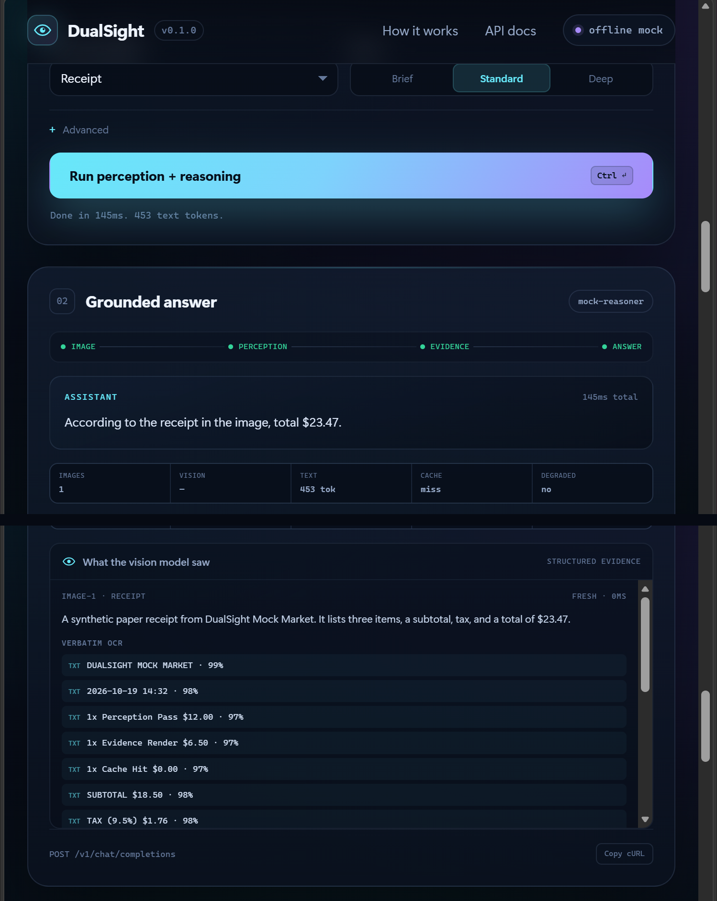

# DualSight

**给你的纯文本 LLM 装上眼睛。**

DualSight 是一个自托管、兼容 OpenAI 接口的**视觉感知边车（perception sidecar）**。它把图片发给第二个具备视觉能力的模型，将结果整理成紧凑、结构化的证据，再注入你现有的纯文本模型提示词中。推理模型始终看不到像素。

[English](README.md) · [架构](docs/architecture.md) · [API](docs/api.md) · [模型提供商](docs/providers.md) · [感知数据格式](docs/perception-schema.md)

<p align="center">
  
</p>

```text
客户端 ── 图片 + 问题 ──▶ DualSight ──▶ 视觉模型（第二个 API）
                              │
                              ├── 结构化感知结果（JSON）
                              ├── 带随机 nonce 的证据块
                              ▼
                        纯文本推理模型 ──▶ 有依据的回答
```

## 为什么需要它

纯文本模型便宜、快、生态成熟，而且往往已经在你的业务里。给它加视觉能力通常只有三条路：

- 换成多模态模型；
- 为每次请求支付图片 token；
- 或者临时拼一个“描述这张图”的提示词。

DualSight 把视觉变成**基础设施层**：一个兼容 OpenAI 的端点，背后可以接任意文本模型；视觉提供商可替换；中间过程留下可审计的证据。它适合在不改变现有模型或工具循环的前提下，为 Agent 增加图像理解能力。

## 特性

- **兼容 OpenAI** 的 `POST /v1/chat/completions`，支持流式输出和工具调用透传。
- **三种原生视觉后端**：OpenAI 兼容接口、Anthropic、Gemini，以及确定性的离线 mock。
- **结构化感知**，不只是 caption：摘要、逐字 OCR、物体、布局、颜色、图表观察、不确定性和建议追问。
- **与问题无关的感知过程**：同一张图可被缓存，并在不同问题之间复用，避免重复调用视觉模型。
- **防提示词注入**：随机 nonce 分隔符、明确的“不可信数据”提示、分隔符转义。
- **按图像内容 + 模型 + profile + detail + prompt 版本缓存**：支持内存、SQLite 或关闭缓存。
- **多图并发感知**，单图失败不影响整体；宁可诚实降级，也不伪造结果。
- **图像净化**：EXIF 方向校正、透明通道铺平、元数据剥离、尺寸/字节上限、远程 URL 的 SSRF 防护。
- **可观测性**：响应中附带 `dualsight` 元数据、图像 ID、缓存命中、延迟、token 用量和截断标记。
- **开箱即用**：CLI（`serve`、`ask`、`perceive`、`doctor`）、浏览器演示、合成样例、测试、Docker 和 CI。

## 快速开始

### 1. 安装

需要 Python 3.10 或更高版本。

```bash
git clone https://github.com/dualsight/dualsight.git
cd dualsight
python -m venv .venv
source .venv/bin/activate        # Windows: .venv\Scripts\activate
pip install -e .
```

### 2. 离线试用

不需要 API Key，不联网，不调用真实模型：

```bash
dualsight serve --mock
```

打开 <http://127.0.0.1:8000/>。选择合成收据、图表、UI 或架构图，运行演示。mock 会返回固定但自洽的感知结果，方便离线验证完整的流式与渲染链路。

### 3. 接入真实模型

```bash
cp .env.example .env
```

至少配置一个视觉 Key 和一个文本 Key，例如：

```dotenv
DUALSIGHT_VISION_PROVIDER=openai
DUALSIGHT_VISION_API_KEY=sk-...
DUALSIGHT_VISION_MODEL=gpt-4o-mini

DUALSIGHT_TEXT_PROVIDER=openai
DUALSIGHT_TEXT_API_KEY=sk-...
DUALSIGHT_TEXT_MODEL=gpt-4o-mini
```

然后：

```bash
dualsight serve
```

API 默认监听 `http://127.0.0.1:8000/v1`，交互式文档在 `/docs`。

### Docker

```bash
cp .env.example .env
docker compose up --build
```

演示和 API 暴露在 `8000` 端口。生产环境请参考[部署说明](docs/deployment.md)。

## 调用 API

DualSight 接受 OpenAI chat-completions 的请求结构。图片放在普通的 `image_url` content part 中，支持 `data:` URI 和公开的 `http(s)` URL。`model` 填 `"dualsight"`（或你为文本模型配置的模型名）。

```bash
curl http://127.0.0.1:8000/v1/chat/completions \
  -H "Content-Type: application/json" \
  -H "Authorization: Bearer $DUALSIGHT_SERVER_API_KEY" \
  -d '{
    "model": "dualsight",
    "messages": [
      {
        "role": "user",
        "content": [
          {"type": "text", "text": "总价是多少？我应该再核对什么？"},
          {
            "type": "image_url",
            "image_url": {
              "url": "https://example.com/receipt.png",
              "detail": "high"
            }
          }
        ]
      }
    ],
    "dualsight": {
      "profile": "receipt",
      "detail": "standard",
      "include_perception": true
    }
  }'
```

响应是标准 chat completion，额外带一个 `dualsight` 对象：

```json
{
  "id": "chatcmpl-...",
  "object": "chat.completion",
  "model": "gpt-4o-mini",
  "choices": [
    {
      "index": 0,
      "message": {
        "role": "assistant",
        "content": "总价是 $23.47。小计 $18.50，税 $1.76，金额相加正确。"
      },
      "finish_reason": "stop"
    }
  ],
  "usage": {"prompt_tokens": 1234, "completion_tokens": 42, "total_tokens": 1276},
  "dualsight": {
    "version": "0.1",
    "nonce": "ef84d0f52c67eccd",
    "image_count": 1,
    "degraded": false,
    "images": [
      {
        "id": "f1b60c5695bd",
        "label": "image-1",
        "source": "example.com",
        "mime_type": "image/png",
        "width": 760,
        "height": 1080,
        "provider": "openai",
        "model": "gpt-4o-mini",
        "profile": "receipt",
        "detail": "standard",
        "cached": false,
        "latency_ms": 1840,
        "prompt_tokens": 607,
        "completion_tokens": 261,
        "truncated": false,
        "error": null
      }
    ],
    "vision_usage": {"prompt_tokens": 607, "completion_tokens": 261, "total_tokens": 868}
  }
}
```

设置 `stream: true` 使用 SSE。最后一个内容块携带相同的 `dualsight` 元数据，随后是仅含 usage 的块和 `[DONE]`。

### 请求选项

| 字段 | 取值 | 默认 | 作用 |
| --- | --- | --- | --- |
| `profile` | `auto`、`photo`、`document`、`ui`、`chart`、`receipt`、`diagram` | `auto` | 引导感知提示词。选择最接近的类型可改善 OCR 与布局细节。 |
| `detail` | `brief`、`standard`、`deep` | `standard` | 控制视觉模型输出的证据量。 |
| `bypass_cache` | 布尔 | `false` | 强制重新执行感知。 |
| `include_perception` | 布尔 | `false` | 在 `dualsight.images[].perception` 中返回完整结构化 JSON。 |

原生端点：

| 端点 | 用途 |
| --- | --- |
| `POST /v1/chat/completions` | 兼容 OpenAI 的桥接端点。 |
| `POST /v1/perceive` | 只执行感知，返回证据和结构化 JSON。 |
| `POST /v1/vision/ask` | 直接向视觉模型提问，不经过文本模型。 |
| `GET /v1/models` | 列出配置的推理模型。 |
| `GET /v1/dualsight/info` | 运行时提供商、特性与端点信息。 |
| `GET /healthz` | 健康检查。 |

每个端点的示例见 [docs/api.md](docs/api.md)。

## CLI

```bash
dualsight serve [--host 0.0.0.0] [--port 8000] [--mock] [--no-demo]
dualsight ask receipt.png "总价是多少？" --profile receipt
dualsight perceive receipt.png --profile receipt --json
dualsight doctor --json
```

`ask` 和 `perceive` 接受本地路径、`data:` URI 或公开的 `http(s)` URL。`doctor` 打印脱敏后的有效配置，并检查每个已配置的提供商是否具备 Key。

## 工作流程

1. **图像接收**：Pillow 解码、EXIF 方向校正、透明通道铺平、剥离元数据、按上限缩放、重新编码并计算哈希。远程 URL 在拉取前会检查私网/链路本地地址。
2. **感知**：一个与问题无关的提示词要求视觉模型输出固定 JSON 结构。解析器兼容带代码围栏的 JSON、嵌套包装和纯文本降级。
3. **渲染**：将感知结果渲染成有长度上限的文本块，用 `<<<VISUAL_EVIDENCE nonce>>> ... <<<END_VISUAL_EVIDENCE nonce>>>` 包裹，并明确标注为不可信数据。
4. **推理**：证据注入第一条 system 消息（或最后一条 user 消息），原图片被替换为文本占位符，然后调用文本模型。提供商支持时，工具调用原样透传。
5. **报告**：响应携带来源信息：提供商、模型、profile、缓存命中、延迟、token 用量、截断和降级状态。

完整时序、缓存键和失败模式见 [docs/architecture.md](docs/architecture.md)。

## 配置

所有配置使用 `DUALSIGHT_` 前缀，可来自进程环境或 `.env` 文件，进程环境优先。完整列表见 [`.env.example`](.env.example)。

| 变量 | 默认值 | 说明 |
| --- | --- | --- |
| `DUALSIGHT_HOST` / `DUALSIGHT_PORT` | `127.0.0.1` / `8000` | `dualsight serve` 的监听地址。 |
| `DUALSIGHT_SERVER_API_KEY` | 未设置 | 设置后，客户端必须发送 `Authorization: Bearer <key>`。 |
| `DUALSIGHT_VISION_PROVIDER` | `openai` | `openai`、`anthropic`、`gemini` 或 `mock`。 |
| `DUALSIGHT_VISION_MODEL` | 提供商默认 | 提供商支持的任何模型。 |
| `DUALSIGHT_VISION_API_KEY` | 未设置 | 依次回退到 `DUALSIGHT_API_KEY` 和提供商原生 Key。 |
| `DUALSIGHT_TEXT_PROVIDER` | 同视觉 | 可以与视觉提供商不同。 |
| `DUALSIGHT_TEXT_MODEL` | 提供商默认 | 推理模型。 |
| `DUALSIGHT_TEXT_API_KEY` | 未设置 | 当两个角色使用同一 base URL 时回退到视觉 Key。 |
| `DUALSIGHT_CACHE` | `memory` | `none`、`memory` 或 `sqlite`。 |
| `DUALSIGHT_CACHE_PATH` | `.dualsight/cache.sqlite3` | SQLite 缓存路径。 |
| `DUALSIGHT_MAX_IMAGES` | `8` | 单请求图片上限。 |
| `DUALSIGHT_MAX_EVIDENCE_CHARS` | `12000` | 证据总预算，按图片拆分。 |
| `DUALSIGHT_ON_VISION_ERROR` | `degrade` | `degrade` 注入诚实的“不可用”块；`fail` 直接报错。 |
| `DUALSIGHT_INJECT_MODE` | `system` | `system` 或 `user`。 |
| `DUALSIGHT_ALLOW_MODEL_OVERRIDE` | `false` | 允许客户端任意指定文本模型。 |
| `DUALSIGHT_MOCK` | `false` | 强制使用离线 mock。 |

当 `DUALSIGHT_*` Key 缺失时，会使用 `OPENAI_API_KEY`、`ANTHROPIC_API_KEY`、`GEMINI_API_KEY` 作为回退。

## 安全与隐私

- **图片会离开你的机器。** DualSight 会把图片发送给配置的视觉提供商。不要用它处理不允许分享给该提供商的图片。
- **元数据会被剥离**，包括 EXIF 和大部分容器元数据。
- **远程图片 URL 默认做 SSRF 检查**。回环、私网、链路本地、组播、保留和未指定地址会被阻止；重定向次数受限。只有在可信网络中才应设置 `DUALSIGHT_ALLOW_PRIVATE_IMAGE_URLS=true`。
- **图片中的文字是不可信数据。** 证据用 nonce 分隔，分隔符会被转义，bridge note 会告诉推理模型不要执行图片里的指令。这能降低但不能完全消除提示词注入风险。
- **API 鉴权是可选的，但强烈建议开启**，只要服务不只监听 localhost。生产环境请放在 TLS 和反向代理之后。
- **请求限制**覆盖请求体、图片字节、像素、尺寸、图片数量和证据长度。

威胁模型和漏洞报告流程见 [SECURITY.md](SECURITY.md)。

## 限制

- 只支持静态图片；不支持视频、PDF 或多页文档解析。
- 感知质量受视觉模型限制。低分辨率、罕见文字和密集表格可能产生 OCR 错误；证据中会包含不确定性。
- 感知过程是“全面描述”而非“针对问题”，这是为了缓存复用而做的取舍，视觉 token 成本会高于窄问题。
- 缓存键包含图片字节、提供商、模型、profile、detail 和 prompt 版本。修改提示词会按设计使缓存失效。
- 工具调用会透传，但桥接层本身不执行工具。
- 没有多租户隔离、配额或计费。每个信任边界运行一个实例。

## 开发

```bash
pip install -e ".[dev]"
ruff check src tests
ruff format --check src tests
pytest
```

测试套件不联网、不需要真实 API Key，覆盖配置、图像接收与 SSRF 规则、渲染与截断、解析/缓存、请求校验、所有提供商（mock HTTP）、桥接层和 HTTP 服务。

```
src/dualsight/
  bridge.py          编排：接收 -> 感知 -> 证据 -> 文本模型
  perception.py      感知调用、宽容 JSON 解析、缓存集成
  render.py          nonce 分隔的证据块
  prompts.py         感知系统提示词、profile、bridge note
  image_intake.py    解码、归一化、哈希、URL 拉取、SSRF 检查
  providers/         OpenAI 兼容、Anthropic、Gemini、mock、传输层
  server.py          FastAPI 应用与兼容 OpenAI 的端点
  wire.py            请求解析与校验
  cache.py           内存 / SQLite 感知缓存
  cli.py             serve、ask、perceive、doctor
  static/            离线浏览器演示与合成样例
tests/               pytest 测试套件
docs/                架构、API、提供商、数据格式、部署文档
```

## 贡献

欢迎提交 Issue 和 Pull Request。请先阅读 [CONTRIBUTING.md](CONTRIBUTING.md)。安全漏洞请按 [SECURITY.md](SECURITY.md) 的流程私下报告，不要开公开 Issue。

## 许可证

MIT © DualSight Contributors。见 [LICENSE](LICENSE)。
